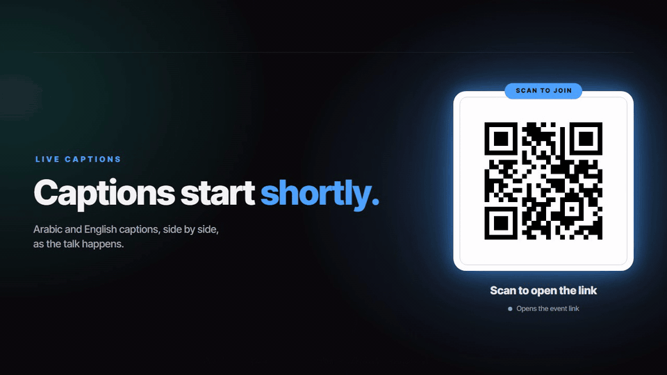

# Bilingual Captions

[](https://github.com/HamzaAhmedWajeeh/bilingual-captions/actions/workflows/tests.yml)

Live two-way captions on a venue screen: someone speaks Arabic and the screen
shows English, someone answers in English and the screen shows Arabic.



<sub>Recorded from `/screen` on the neutral theme, replaying a capture written for it.</sub>

- **Two-way, with nobody switching anything.** Direction is decided per
  paragraph from the speech itself, and only the translated side is shown.
- **Main-screen first.** The projector view is the product. Nothing to install,
  and nothing for the audience to scan unless you add a join link.
- **Offline-testable.** Saved engine responses replay through the real caption
  pipeline at real speed, so you can judge the screen without spending anything.
- **One process.** FastAPI, a WebSocket, three static pages. No database, no
  frontend framework, no build step.
- **Unbranded.** Colours, wording, logos and the join link all come from one
  gitignored file and one folder.

Speech recognition and translation are done by [Soniox](https://soniox.com), so
you need an API key. Everything else runs on your machine.

## Quick start

Python 3.12 or newer and [uv](https://docs.astral.sh/uv/). On Linux, install
PortAudio first: `sudo apt-get install libportaudio2`.

```sh
git clone https://github.com/HamzaAhmedWajeeh/bilingual-captions
cd bilingual-captions
uv sync
cp .env.example .env            # PowerShell: Copy-Item .env.example .env
```

Put your key in `.env` as `SONIOX_API_KEY=your-key-here`, the only required
value, then start the server:

```sh
uv run uvicorn app.main:app --host 127.0.0.1 --port 8000
```

The first run writes an admin token to `.env` and prints the operator URL once:
open that for `/admin`, and drag `/screen` onto the projector.

Live audio has only been tested on Windows. Full setup: [docs/setup.md](docs/setup.md).

## Configuration

- [docs/setup.md](docs/setup.md) - install per OS, PortAudio, audio input, repository layout
- [docs/operating.md](docs/operating.md) - `/screen`, `/admin`, the HTTP API, cost control
- [docs/branding.md](docs/branding.md) - colours, wording, logos, the join link
- [docs/testing.md](docs/testing.md) - the offline suite, browser tests, captures
- [docs/privacy.md](docs/privacy.md) - what stays on the laptop, and why

## Cost

Roughly $0.20 per hour of live audio on this project's own usage, and replay
costs nothing: [spend control](docs/operating.md#cost-and-spend-control).

## Licence

MIT. See [LICENSE](LICENSE).
